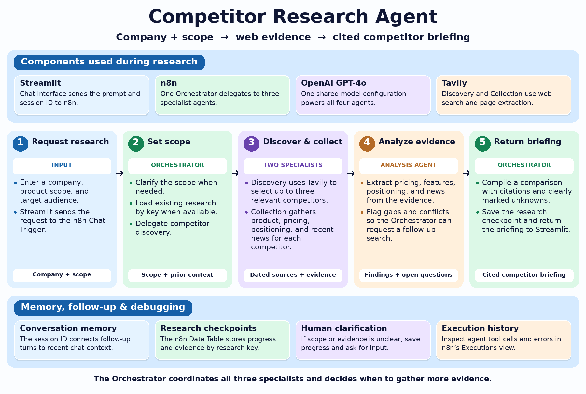

# Competitor Research — Streamlit frontend

A chat frontend for the existing n8n multi-agent competitor research backend.
Requires Python 3.10+ and a published n8n chat endpoint.

## 1. Open in VS Code

Extract this project, then use File → Open Folder → competitor-research.
Alternatively open competitor-research.code-workspace.

Open Terminal → New Terminal inside VS Code.

macOS / Linux:

```bash
python3 -m venv .venv
source .venv/bin/activate
python -m pip install -r requirements.txt
cp .streamlit/secrets.toml.example .streamlit/secrets.toml
```

Windows PowerShell:

```powershell
py -m venv .venv
.venv\Scripts\Activate.ps1
python -m pip install -r requirements.txt
Copy-Item .streamlit/secrets.toml.example .streamlit/secrets.toml
```

In VS Code, run Python: Select Interpreter and select the .venv interpreter.

## 2. Connect n8n

Open Research Chat. Enable Make Chat Publicly Available and choose Embedded Chat.
Choose When Last Node Finishes as the response mode for this non-streaming client.
Keep the Orchestrator as the final response-producing node (output field).
Copy the Chat URL from n8n, save, and publish the workflow.

Paste the production Chat URL into .streamlit/secrets.toml as N8N_CHAT_URL.
Do not use the workflow editor URL or the temporary test URL for regular use.
If your endpoint requires Basic Auth or a header, configure the matching optional
settings from the example file. Secrets stay in the Streamlit Python process.
Tavily and model credentials remain in n8n; they are not needed by this app.
Do not commit secrets.toml or expose a deployed app to others unintentionally.

## 3. Run

```bash
python -m streamlit run app.py
```

Open the localhost address printed in the terminal (normally http://localhost:8501).
Or choose Run Streamlit in VS Code's Run and Debug panel after selecting .venv.

First test: "Hello. Ask me which company I want to research."
Then test a full company request and a follow-up correction.

## Request / response contract

The app POSTs JSON to the Chat URL:

```json
{"action":"sendMessage","sessionId":"unique-browser-session-id","chatInput":"Research Notion competitors"}
```

It expects an object (or one-item list) with a text output field:

```json
{"output":"The briefing or clarification question in Markdown"}
```

The app uses a 180-second read timeout and does not retry requests automatically.
It deliberately does not parse streaming event responses.

## State and memory

- Streamlit session_state retains the displayed conversation and sessionId while
  the browser session remains alive. Refreshing/reconnecting can reset it.
- n8n Conversation Memory receives the same sessionId on each follow-up.
- Persistent research checkpoints remain in n8n's Data Table. Enter a saved
  research_key in the sidebar and ask to continue to retrieve previous research.
- New conversation resets chat context; it does not delete research checkpoints.
- Download conversation exports visible messages to Markdown.

## Troubleshooting

- HTTP 404: check the production URL and publish the workflow.
- HTTP 401/403: match endpoint authentication with the optional secrets settings.
- Invalid JSON / missing output: turn off streaming via When Last Node Finishes;
  inspect the final node output and republish.
- Timeout: inspect n8n Executions before resubmitting. n8n or a proxy may time out
  sooner than this client; long research jobs need an asynchronous job/status API.
- Endpoint configured only means the URL is set; it is not a connectivity test.

## Deployment later

For Streamlit Community Cloud, put these files in a GitHub repository without
secrets.toml, select app.py as the entry point, and add the TOML secrets in the
app's deployment settings. This project does not deploy anything automatically.

## Validation

Python syntax and project packaging were checked. Live end-to-end integration
must be checked after you supply the Chat URL and configure/publish n8n.

## Architecture and workflow import



Import n8n/workflow.json into n8n. Select an OpenAI credential for Research
Model and a Tavily credential for both Tavily nodes. Create a Data Table with
research_key (string), record_type (string), payload_json (string), and saved_at
(date). Select it on both checkpoint tools and verify their column mappings.
Review the Chat Trigger settings above before publishing. The export omits
instance-specific credential and Data Table bindings.
